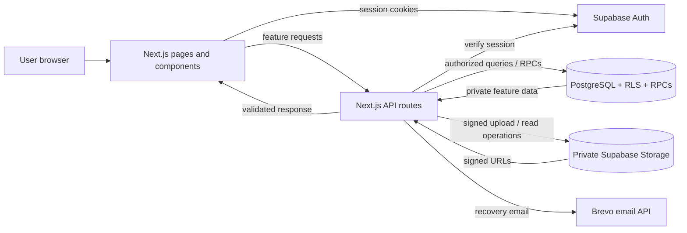
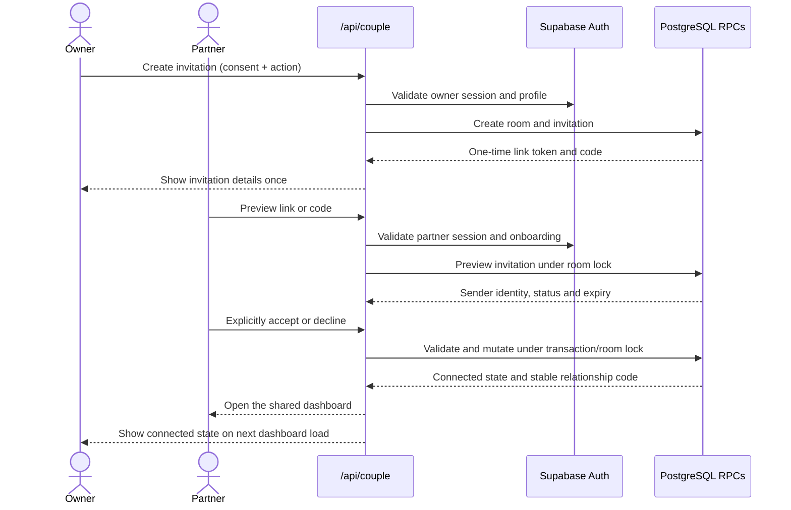
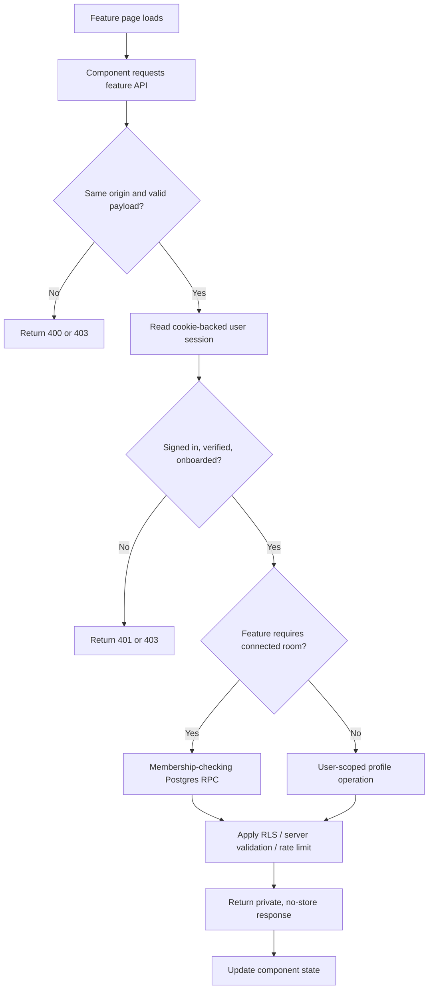

# Shuvia System Design and Data Flow

This document describes how the current Shuvia application is structured and how data travels through it. It is a companion to the setup and feature notes in the [project README](../README.md).

## System at a glance

Shuvia uses the Next.js App Router for pages and server-side API routes. Supabase provides authentication, PostgreSQL, row-level security (RLS), and private object storage. The browser talks to Shuvia's server routes for protected application features; server code validates the signed-in user and performs the authorized database operation.



## Main layers

| Layer | Responsibilities |
| --- | --- |
| `src/app` | Route pages, layouts, loading and error states, and API route handlers. |
| `src/components` | Interactive UI, forms, dashboards, and feature components. |
| `src/lib` | Supabase clients, authentication helpers, validation schemas, rate limiting, and feature utilities. |
| Supabase Auth | Password and session management, verified-email status, and recovery tokens. The session is carried in secure cookies through the SSR client. |
| PostgreSQL | Profiles, preferences, couple spaces, and feature records. RLS and database functions enforce ownership and room membership. |
| Supabase Storage | Private avatar and memory-photo objects. The server checks ownership/membership and issues expiring signed URLs. |
| Brevo | Transactional recovery email delivery initiated from the server. |

The browser Supabase client is for browser-side session-aware operations where used. The server Supabase client uses the user's cookie-backed session. The admin client uses the service-role key and must remain server-only; do not expose it through a `NEXT_PUBLIC_` variable or call it from a client component.

## Request and data flows

### Sign up, login, and onboarding

```mermaid
sequenceDiagram
  actor User
  participant UI as Next.js form
  participant API as Next.js API / Auth callback
  participant Auth as Supabase Auth
  participant DB as PostgreSQL

  User->>UI: Submit credentials
  UI->>Auth: Sign up or sign in using SSR client
  Auth-->>UI: Session / verification state
  Auth-->>User: Verification email when required
  User->>API: Open callback link
  API->>Auth: Exchange callback code for session
  API-->>User: Redirect to next allowed page
  User->>API: Submit onboarding answers
  API->>Auth: Read and verify current user
  API->>DB: Validate rate limit and save profile/preferences
  DB-->>API: Saved result
  API-->>UI: Success response; continue to /home
```

The onboarding endpoint checks request origin, session, confirmed email, payload schema, and rate limit before writing. A profile row must exist before dependent preference rows can satisfy their foreign key. Server errors should be diagnosed from the API response and server log; do not paste a migration filename into the Supabase SQL editor. Open the SQL migration itself and execute its SQL contents, in order.

### Create and accept a couple invitation



The link token is high entropy and stored as a hash; the short code is stored as an HMAC. Invitations expire after 24 hours and are shown only at creation. Opening an invitation never connects users. The recipient must explicitly accept; acceptance is transactional and idempotent, and the existing inviter consent plus recipient consent opens the shared dashboard immediately. The separate relationship code is an identifier only and cannot be used to join. Disconnect closes membership while retaining shared records privately and preventing former members from accessing them.

### Reading and writing a private feature



Games, letters, surprises, memories, special days, settings, and couple dashboard routes each have their own API handlers. Inputs are validated on the server. Couple feature access is checked against active membership; table grants and RLS/RPC boundaries limit direct access. Private responses should not be cached publicly.

### Memory photos and avatars

1. The browser selects a photo; memory images are resized/encoded client-side where supported.
2. The API verifies the session, file size/type/signature, rate limit, and the user's private scope.
3. The server uploads to a private bucket and records the object path in the database.
4. For display, the server checks the record's owner or active room membership, then creates a short-lived signed URL.
5. Deleting a record removes its associated object. Disconnecting retains shared records privately and removes former members' access; confirmed account deletion removes the account's shared space and content.

Never make these buckets public or store a permanent public image URL in the UI.

## Data ownership and lifecycle

- **Account data:** `profiles` and `user_preferences` belong to a single Auth user. The profile ID references the Auth user ID; dependent rows reference the profile.
- **Couple data:** Shared feature rows are scoped to a couple-space ID and access requires active membership. Each room has two members at most.
- **Invitation data:** Secrets are hashed or HMAC-protected in the database. The raw link token/code is returned only at creation.
- **Stored files:** Avatar keys are user-scoped; memory keys are room-scoped. Buckets are private.
- **Disconnect:** Membership ends, shared records remain stored but former members cannot access them. Confirmed account deletion removes the associated shared space and content. Individual account data remains until its owner deletes it.
- **Account deletion:** The account settings flow closes an active room, removes related shared files/data, revokes sessions, then deletes the current Auth user.

## Security boundaries

- Keep `SUPABASE_SERVICE_ROLE_KEY`, `AUTH_FLOW_SECRET`, and `BREVO_API_KEY` on the server only.
- Use the cookie-backed server client to identify the actor. Never accept a user ID from a request body as proof of identity.
- Validate same-origin writes, schemas, authorization state, and rate limits before mutating data.
- Use RLS and narrow Postgres functions as database-side enforcement; API checks alone are not the only boundary.
- Do not return scheduled letter contents before release, another user's private profile fields, raw invitation secrets after creation, or file objects without a fresh authorization check.
- Keep logs free of passwords, access tokens, recovery tokens, invitation secrets, letter bodies, and private photo data.

## Local development and migration setup

1. Copy `.env.example` to `.env.local` and add the required project values. Never commit `.env.local`.
2. Apply Supabase migrations in filename order from `supabase/migrations/` using the Supabase CLI or the SQL editor. In the SQL editor, paste the contents of a `.sql` file, not its filesystem path.
3. Configure Auth email confirmation and local/production callback URLs in Supabase.
4. Start the app with `npm run dev` and open `http://localhost:3000`.
5. Apply a new migration before testing the feature that depends on it. The README's feature sections describe the corresponding migrations and manual two-account checks.

Useful local commands:

```bash
npm run dev
npm run typecheck
npm run lint
npm test
npm run build
```

## Change guide

- Add or change a page in `src/app/<route>/`; reusable presentation belongs in `src/components/`.
- Add server-side feature endpoints under `src/app/api/` and validate inputs with schemas/helpers in `src/lib/`.
- Add database changes as a new ordered SQL migration under `supabase/migrations/`; do not silently edit already-applied migrations for a deployed database.
- Keep data access server-authorized and room-scoped. Add/update tests for validators and behavior when changing application logic.
- Update this document and the README when architecture, environment setup, data ownership, or migration order changes.
